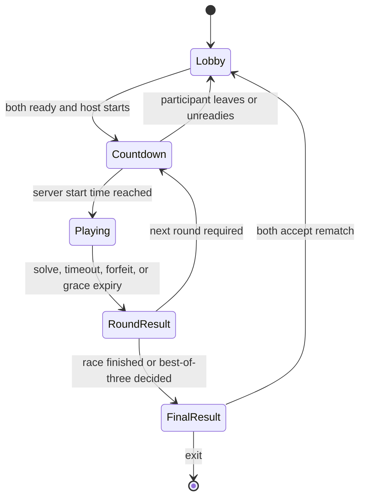

# Database and multiplayer plan

This was the Phase 1 proposal. Phase 2's actual implementation and any departures
from this proposal are recorded in [phase2-delivery.md](phase2-delivery.md).

Status: proposed Phase 2/3 architecture. No migrations have been applied and no
live service has been provisioned. This document describes the design to validate
before enabling multiplayer; it does not claim multiplayer currently works.

## Trust and transport

Use Supabase Auth for identity, Postgres transactions for competitive authority,
and authorized private Realtime channels for server-accepted events. Clients
submit commands through an authenticated Edge Function. It validates the JWT,
derives the actor from it, rate-limits commands, then invokes a server-only
transactional database entry point. Browser-supplied actor IDs, progress, rewards,
solutions, outcomes, ratings, and timestamps are never trusted.

Keep privileged credentials exclusively in Edge Function secrets. Use explicit
privilege grants; revoke function execution from PUBLIC, anon and authenticated
for server-only entry points. Prefer SECURITY INVOKER. If privileged functions
become necessary, keep internal code outside exposed schemas, constrain
search_path, check membership and state inside the transaction, and test every
public wrapper. RLS alone does not replace function authorization.

Use `room:<uuid>` for public-to-members lobby and sanitized match events and a
separate authorized per-player stream or authenticated response for private board
snapshots. Give members permission to receive match events. Do not give clients
permission to broadcast authoritative gameplay messages. Presence permissions
must be restricted separately from Broadcast permissions. Presence is a UI hint,
never the authoritative disconnect clock.

Evaluate latency before introducing a dedicated WebSocket service: instrument
command receipt, database commit, and recipient acknowledgement under expected
regional load. Initial engineering target: p95 accepted-action-to-recipient
latency below 250 ms, to validate with real measurements. If the selected region
and managed transport cannot meet the gameplay budget, retain transactional
authority and move the connection layer to a dedicated service.

## Proposed normalized entities

All IDs are UUID primary keys unless a composite key is specified. Foreign-key
deletion policies must preserve finalized match history and remove ephemeral
membership appropriately. Index foreign keys and actual list/filter paths.

| Entity | Key fields and integrity | Access |
| --- | --- | --- |
| profiles | id → auth.users; username + unique lowercase index; cosmetic avatar/title references; created_at | Public display fields only; owner can edit allowed display fields, never ratings |
| player_settings | user_id PK/FK; motion, contrast, input preferences | Owner only |
| rooms | host_id; unique indexed code; mode; difficulty; time_limit; state; expires_at; version | Members only; joining by code uses a rate-limited server command |
| room_players | PK(room_id,user_id); seat; ready; joined_at; unique(room_id,seat); seat constrained to 1 or 2 | Members read sanitized lobby; all writes server-validated |
| matches | room_id; mode; status; best_of; starts_at; deadline; winner_id nullable; outcome; version | Participants read sanitized state; server writes |
| match_players | PK(match_id,user_id); seat; rounds_won; last_heartbeat; disconnect_deadline | Only participant-safe fields visible to both players |
| match_rounds | match_id; round_number; clues; status; starts_at; deadline; winner; unique(match_id,round_number) | Participants read clues and round metadata |
| private.round_solutions | round_id PK/FK; solution[81]; generation metadata | Private, non-exposed schema; no browser grants, including after completion unless explicitly revealed |
| private.round_player_state | PK(round_id,user_id); values[81]; energy 0–5; completion_at; state_version | Server only; authenticated snapshot returns own values only |
| private.unit_rewards | PK(round_id,user_id,unit_type,unit_index); awarded_at | Immutable one-time reward ledger; server only |
| player_moves | round_id; actor_id; action_id; cell 0–80; digit 0–9; accepted_at; version; unique(actor_id,action_id) | Private audit; never exposed as an opponent move feed |
| match_events | match_id; monotonically increasing sequence; type; sanitized payload; created_at; unique(match_id,sequence) | Participants replay safe events; index(match_id,sequence) |
| skill_effects | round_id; source; target; skill; action_id; starts_at; expires_at; consumed_at | Participants see effect metadata, not puzzle secrets |
| player_stats | user_id PK; matches; wins; losses; draws; updated_at | Server-derived summaries, never owner-writable counters |
| cosmetics | SKU unique; kind; visual configuration; active | Public read; catalog administration only |
| player_inventory | PK(user_id,cosmetic_id); acquisition source; acquired_at | Owner read; server writes and validates equipment ownership |
| achievements / player_achievements | Definition key unique; PK(user_id,achievement_id) | Public definitions; server-earned awards |
| friendships | canonical user pair unique; status; requester; check users differ | Pair members only; constrained state transitions |
| player_reports | reporter; target; match_id; reason code; optional bounded detail | Reporter receipt and moderators only; no public report content |

Community posts, reactions, and comments wait until Phase 4. Avoid speculative
tables before those contracts are tested. Cosmetics can grant visual differences
only. Real payments are outside the initial MVP.

Enable RLS on every exposed table and schema object with browser grants. Membership
checks must use indexed keys and avoid recursive room_players policies; use a
reviewed membership helper where needed. Test UPDATE with both USING and WITH
CHECK, and provide the required SELECT policy. Public views must use
security_invoker or be inaccessible. Private schema separation is essential:
putting solutions in an unreadable column of a broadly readable row is unsafe.
Run Supabase advisors and negative authorization tests before launch.

## Atomic command contract

Every mutating command carries a random `action_id`, resource ID, and expected
state version. Never accept an actor ID from the payload. Repeated action IDs
return their stored result, without repeating any side effects.

1. Authenticate and enforce per-user/per-room rate limits.
2. Start one transaction; acquire the match/round lock before player-state locks,
   using the same lock order for moves, skills, expiry, and forfeits.
3. Verify membership, seat, lifecycle state, server time, version, and action ID.
4. Validate action against fixed clues and the server-only solution. Incorrect
   competitive moves return rejected feedback without advancing confirmed state.
5. Apply entries, unique reward ledger entries, energy caps, effect changes,
   progress, and any outcome in the same transaction.
6. Increment state version, append the durable sanitized event, persist the
   idempotent result, and commit.
7. Broadcast only after commit. Prefer a transactional outbox and retrying
   delivery; clients deduplicate by match and sequence and fetch snapshots if gaps
   appear. Broadcast failure never rolls back an already accepted move.

Notes and selection remain local. A changed expected version returns a conflict
and the actor's fresh snapshot. Accepted commands use server receipt and commit
ordering; client latency is never disguised as authoritative timing.

## Match lifecycle and edge cases

- Create/join: cryptographically random room codes with uniqueness retry, two
  seats enforced transactionally, invite expiry, rate limits against enumeration.
  A code authorizes the join request; it does not grant direct table reads.
- Start: host-only command, both players ready, same clues and future server
  starts_at timestamp (3-second countdown), immutable settings after countdown.
- Clock: clients estimate server offset from response timing and render remaining
  time locally. All eligibility and expiry decisions use database time.
- Winner: serialize completion transactions under the round lock. First valid
  completion accepted by the server wins; this policy favors server receipt,
  not client-reported time. Once terminal, later commands cannot change the
  result. Timeout compares server-confirmed progress; equal progress is a draw.
  No latency tie window is implied. Review this rule before ranked release.
- Timeout: a server scheduler finalizes expired rounds even when neither player
  sends another command. Every command also checks deadline under lock. Never
  depend on a browser interval to end the round.
- Disconnect: persisted, authenticated heartbeat every 5 seconds, disconnected
  after 15 seconds without heartbeat, then a 30-second grace deadline. Continue
  the round clock. Reconnection before deadline cancels disconnect forfeiture.
  Server jobs enforce grace and timeout; if both abandon, record abandoned/draw
  according to the active rules version rather than awarding an arbitrary win.
- Reconnect: validate membership, obtain own board snapshot, energy, effect
  timestamps, round state, server time, and event cursor; subscribe, replay from
  cursor, and reconcile versions to close the subscribe/snapshot race. Rebuild
  active overlays from expiry timestamps rather than replaying attacks.
- Rematch: separate mutually accepted lobby; new match and puzzle IDs. Never
  reopen a terminal match or reuse its energy/reward ledger.
- Inactivity: warn after a configured no-action interval; active connection alone
  must not create unlimited room reservations. Apply a published server-side
  policy, independent of network disconnect grace.

## Phase 3 configurable battle rules

Use a server-owned, versioned rule object saved with the match. A client copy
drives labels only. Rows and columns award +1, boxes +2, maximum energy 5.
Reward inserts have unique unit keys, including when the meter is capped, so
erasing/re-entering cannot create another reward. Ignore units already completed
by initial clues when establishing the initial ledger.

| Skill | Cost | Duration | Validation and expiry |
| --- | --- | --- | --- |
| Fog | 1 | 3 seconds | Server selects a 3×3 region; display concealment only |
| Freeze | 2 | 1.5 seconds | Server rejects number-entry commands during freeze, not just the UI |
| Scramble | 2 | 5 seconds | Permutes displayed keypad order; each key retains its displayed numeric value |
| Shield | 2 | 10 seconds or next hit | One active shield; reactivation while active rejected; consumption atomic with incoming attack |

Proposed balancing defaults: 1-second global cast cooldown, one active effect per
skill/target, no duration stacking; recasting the same active effect is rejected
without energy deduction. Opponent shields consume on the next otherwise legal
incoming attack; the attack still costs its caster energy. Record and test these
choices rather than allowing client-specific interpretations. These defaults are
proposals until battle playtesting.

All effects store absolute server times. Expiry is valid by time even if the
cleanup job runs late. Cleanup removes expired records and overlays, and new
rounds clear all previous effects. Shield, energy, and outgoing attack changes
share a transaction and action ID to prevent double spending and duplicate hits.

## Required integration gates

Before enabling private rooms, test with two independent authenticated browsers:
create/join/invite, third-player refusal, unauthorized subscription, ready/start,
same puzzle, hidden opponent digits and solution, accepted and rejected moves,
timeout with both browsers closed, concurrent near-simultaneous finishes,
duplicate actions, disconnect/grace/reconnect, resubscription gaps, rematch, and
cross-room access denial. Add PostgreSQL concurrency tests and actual RLS tests.

Battle release additionally requires one-time reward, energy cap, concurrent
spend, duplicate attack, shield consume/expiry, effect overlap, freeze command
rejection, reconnect during effects, round transition cleanup, and best-of-three
tests. Ranked stays disabled until these and outcome/rating contracts pass.

Create migrations using the installed CLI's supported commands after checking
`--help` and current changelog. Verify in local Supabase, run advisors, commit
versioned SQL and seed data, and apply to a staging project before production.

## Primary references

- [RLS and authorization](https://supabase.com/docs/guides/database/postgres/row-level-security)
- [Realtime channel authorization](https://supabase.com/docs/guides/realtime/authorization)
- [Database function security](https://supabase.com/docs/guides/database/functions)
- [Supabase changelog](https://supabase.com/changelog)

These inform the proposed access boundary; actual policies, migrations, and
latency behavior still require implementation and testing.
